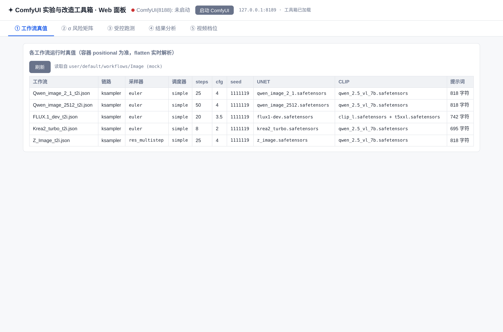
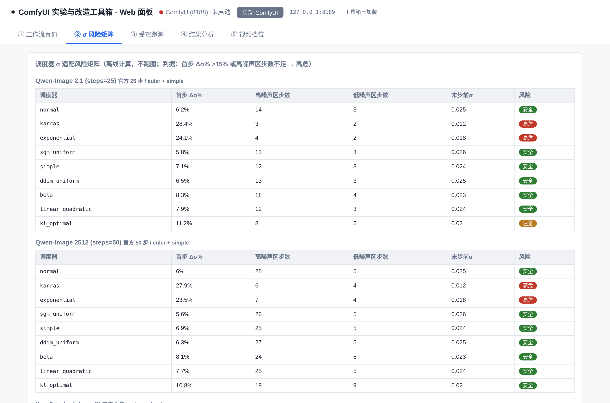
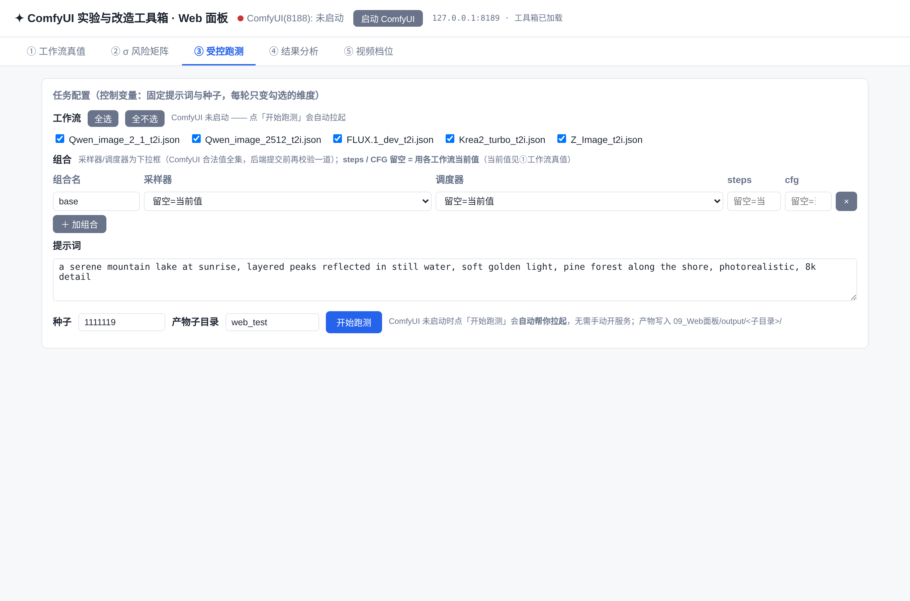
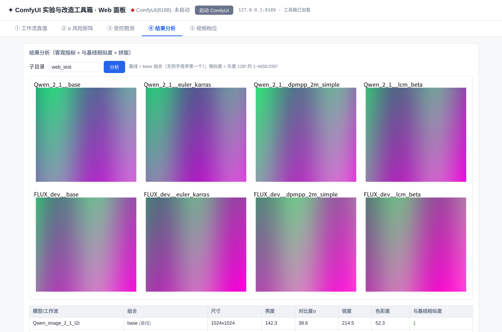

<div align="center">

# ComfyUI Experiment Toolbox

**ComfyUI 采样器/调度器受控实验 + 工作流结构改造工具箱**
A two-track **script toolbox + zero-dependency Web panel** that drives one local ComfyUI — **not a ComfyUI custom-node plugin**.

[](https://github.com/ReSerendipity/ComfyUI-Experiment-Toolbox/actions/workflows/ci.yml)
[](LICENSE)
[](https://www.python.org/)
[](https://github.com/ReSerendipity/ComfyUI-Experiment-Toolbox/commits/main)
[](#-参与方式)

[中文](#中文) · [English](#english)

</div>

---

## 中文

### 这是什么

一个围绕**一台本机 ComfyUI** 的脚本工具箱：两条流水线 + 一个浏览器面板。

- **参数实验轨（`01`–`04` + `07`）**：工作流扁平化 → 离线 σ 风险筛 → 控制变量跑测 → 客观指标 + 拼版结论。回答"采样器/调度器/steps/cfg 怎么配对、怎么验证"。
- **结构改造轨（`05` + `08`）**：备份 → 官方模板对齐 → 加槽位 → 清理 → verify。回答"工作流怎么改对"。
- **`09_Web面板`**：纯 Python 标准库（`http.server`）实现的人类用户入口，**零第三方依赖**，浏览器四页覆盖参数轨全流程。
- **`10_模型家族横评`**：同底座换权重的单变量横评（去重、台账、断点续跑、门禁、对账、趋势回归、视频质检、提示词变体闭环）。

> 它**不是** ComfyUI 自定义节点（没有 `__init__.py` / `nodes.py`，不装进 `custom_nodes/`），而是在 ComfyUI 之外跑的脚本集合；只有跑测那一步会通过 `127.0.0.1:8188` 把 API prompt 提交给本机 ComfyUI。

### 核心特性

- **工作流扁平化**：把 `definitions.subgraphs` 子图容器展开成可提交 `/prompt` 的 API 图，bypass 透传、可达性裁剪、类型守卫；反向转换（API 图 → UI 图）供评测产物回流 UI 复核。
- **离线 σ 风险矩阵**：不跑图即可判定调度器适配性（首步 Δσ%、高噪声区步数），7 个 flow-matching 模型 × 9 个调度器的风险表。
- **控制变量跑测**：统一提示词与种子（`dry-run` + `--apply` 自动备份）、参数矩阵、跨模型统一变量、视频时长档位（适配器驱动 + 显存自适应降档）。
- **结果分析**：客观指标（亮度/对比度σ/锐度/色彩度）+ 与 base 基线的 1−MSE 相似度 + 4 列带标签拼版大图。
- **零依赖 Web 面板**：纯标准库 `http.server`，绑定 `127.0.0.1:8189`，不对外网开放；ComfyUI 没起时点「开始跑测」会自动拉起。
- **结构改造全链脚本**：与 ComfyUI 官方模板逐份对照快照（`08_官方模板对齐/`，11 份），模板升级后可一键复查对齐状态。

### 界面预览

> 以下四张图均为本仓 `09_Web面板/panel.py` 在浏览器中的真实界面（截图环境未启动 ComfyUI，表格数据为代表性样例；①② 页本身不需要 ComfyUI）。

**① 工作流真值** —— 每份工作流的运行时参数（容器 positional 值为准），并标出提示词是否为空：



**② σ 风险矩阵** —— 7 模型 × 9 调度器离线判定（高危/注意/安全），不跑图：



**③ 受控跑测** —— 勾选工作流 + 组合（采样器/调度器/steps/cfg 留空 = 用当前值），固定提示词与种子：



**④ 结果分析** —— 客观指标 + 与 base 基线相似度 + 带标签拼版图：



### 快速开始

#### 前置条件

| 项 | 要求 | 说明 |
|---|---|---|
| ComfyUI | 一套可运行的本机 ComfyUI | σ 计算要 `comfy.model_sampling` / `comfy.samplers`，分析要 `numpy` / `Pillow`，用它自带的 Python 最省事 |
| 服务地址 | ComfyUI 启动在 `127.0.0.1:8188` | ② 离线 σ 分析不需要服务；③ 跑测需要 |
| 操作系统 | Windows（一等公民） | 入口为 `run.bat` / `start.bat`；Linux/macOS 可直接用 `python run.py <子命令>` |
| 第三方依赖 | 仅 `numpy` / `Pillow` | 版本锁定在 [`requirements-lock.txt`](requirements-lock.txt)（实测 numpy 2.3.5 / Pillow 12.1.0，Python 3.13.11） |

#### 一条命令启动 Web 面板（推荐）

Windows 下双击根目录 **`start.bat`**，或：

```bat
run.bat panel
```

浏览器自动打开 <http://127.0.0.1:8189>（不想自动开加 `--no-browser`）。①② 页不需要 ComfyUI；③ 页点「开始跑测」时若 ComfyUI 没起，面板会自动拉起。

#### 其它常用子命令

```bat
run.bat              :: 列出全部 19 个入口
run.bat sigma        :: 参数轨① 离线 σ 风险矩阵
run.bat unify --apply:: 参数轨② 统一提示词与种子（先不加 --apply 看 dry-run）
run.bat models       :: 参数轨③ 跨模型跑测
run.bat analyze      :: 参数轨④ 结果分析
run.bat pipeline     :: ①→②→③→④ 一次跑完
run.bat full         :: E3 一键全链（默认全只读 0 提交；--apply 才实跑）
run.bat vqc          :: E1 视频质检（容器/帧/时序三层，只读）
run.bat dur --adapter minimax_h3_t2v --dry-run  :: E4 适配器驱动档位跑测
run.bat ftrend       :: E5 历史趋势回归（跨快照比，检出硬回归 exit 1）
```

> `run.bat` 顶部 `PY=` 变量写死了 ComfyUI 自带 python 的路径（默认 `%USERPROFILE%\APP\ComfyUI-aki-v3.2\python\python.exe`）——**换机器只改这一行**。

#### 最小验证（不依赖 ComfyUI 也能跑）

```bat
python -m unittest discover -s tests -v
python "10_模型家族横评/lib_ledger_verify.py" --selftest
python "05_结构改造脚本/verify_upgrade.py" --selftest
```

这三条也是 CI（`.github/workflows/ci.yml`）在每次 push / PR 上执行的门禁子集。

### 系统要求与兼容性

- **Python**：CI 在 3.11 上跑门禁；实测本机用 ComfyUI 自带 Python 3.13.11。
- **第三方包**：仅 `numpy` / `Pillow`，版本锁定；`http.server`、`argparse`、`hashlib`、`tempfile` 等均为标准库。
- **模型覆盖**：flow-matching 类（Qwen-Image 系、Krea2、FLUX 系、Z-Image 系）的 KSampler 链路。
- **不适用**：Non-KSampler 采样链路（如 MiniMax H3 走 Spectrum 自定义链路——扁平化能跑，但"换调度器"维度不存在）；图生图/编辑类工作流（需参考图，提示词维度不通用）。
- **显卡**：跑测按 11.94 GB 显存标定；显存紧张可用 `03_受控跑测/lib_vram.py` 探测预算与自动降档。

### 使用示例

收编一个新模型/新工作流的标准路径：

1. **结构轨先行**：走 `05_结构改造脚本/` 的备份 → 官方模板对齐 → 加槽位 → verify。
2. **① 工作流真值页**：确认运行时参数（采样器/调度器/steps/cfg/seed/模型）与提示词非空。
3. **② σ 风险矩阵页**：离线判定新模型在哪些调度器上高危，避开 `karras` / `exponential`（flow 系 7/7 高危）。
4. **③ 受控跑测页**：勾选工作流 + base 组合（默认已加）+ 几组对照组合，固定提示词与种子。
5. **④ 结果分析页**：看指标表与拼版图——相似度接近 1 的组合实际等价，对比度/锐度骤降的组合有异常，最终以人眼看图为准。

### FAQ

**Q：这是 ComfyUI 插件吗？要丢进 `custom_nodes/` 吗？**
不是。本仓没有 `__init__.py` / `nodes.py`，它是在 ComfyUI 之外运行的脚本集合；只有跑测那一步通过 `127.0.0.1:8188` 提交 API prompt。

**Q：为什么 ② 页第一次打开要等 20–60 秒？**
σ 计算需要 `import comfy.*` + torch 并遍历 7 模型 × 9 调度器；算完常驻缓存到面板重启。这一步完全离线，不提交任何图。

**Q：换一台机器怎么快速上手？**
只改 `run.bat` 顶部 `PY=` 一行指向 ComfyUI 自带 python；脚本内所有运行时路径都用 `%USERPROFILE%` 展开（`os.path.expandvars`），不需要改脚本本体。

**Q：`steps` / `cfg` 留空是什么意思？**
"用该工作流当前值"（见 ① 页）。base 组合 = 全部留空 = 完全按当前工作流跑，作为后续对照的基线。

**Q：跑测产物去哪找？**
`09_Web面板/output/<子目录>/`，拼版图命名为 `_montage.png`；原始 PNG 由 ComfyUI 写到它自己的 output 目录。

### 文档与治理

- 目录导览、依赖矩阵、硬编码常量表见下方"目录导览"一节。
- 共享结论（采样器×调度器主文档、H3 笔记）：[`06_文档与结论/`](06_文档与结论/)。
- 发布与回滚口径：[`docs/release-governance.md`](docs/release-governance.md)（版本位为 Git tag `v*`）。
- 治理规范：[ReSerendipity/.github/governance](https://github.com/ReSerendipity/.github/tree/main/governance)。
- 变更记录：[`CHANGELOG.md`](CHANGELOG.md)。

### 参与方式

- 提交 Issue / PR 前请读 [`docs/CONTRIBUTING.md`](docs/CONTRIBUTING.md)。
- CI 在每次 push / PR 上跑：语法编译、锁文件解析、11 道纯标准库门禁（台账对账、prompt QC、库存门禁、结构轨 verify、本机路径红线、依赖方向、单元测试、视频质检、趋势回归、显存档位、提示词闭环）。
- Secret 扫描由 [gitleaks](.github/workflows/gitleaks.yml) 在 push / PR 与每周日全量历史扫描上执行。
- 安全问题请走 Issue 或治理规范中约定的私有渠道，不要在公开 Issue 里贴凭据。

### 许可证

[Apache-2.0](LICENSE)。

---

## English

### What is this

A script toolbox built around **one local ComfyUI installation**: two pipelines plus a browser panel.

- **Parameter track (`01`–`04` + `07`)**: workflow flattening → offline σ-risk screening → controlled runs → objective metrics + contact-sheet conclusions. Answers "how to pair sampler/scheduler/steps/cfg and how to validate them".
- **Structure track (`05` + `08`)**: backup → align with official templates → add slots → cleanup → verify. Answers "how to surgically edit a workflow correctly".
- **`09_Web面板`**: a human-facing browser panel implemented **purely on the Python standard library (`http.server`) with zero third-party deps**, four pages covering the whole parameter track.
- **`10_模型家族横评`**: single-variable cross-check across same-architecture checkpoints (SHA256 dedup, prompt ledger, resume-safe runs, inventory gate, ledger↔artifact reconciliation, trend regression, video QC, prompt-variant closed loop).

> It is **not** a ComfyUI custom-node plugin (no `__init__.py` / `nodes.py`, nothing installed into `custom_nodes/`). It is a collection of scripts running outside ComfyUI; only the run step submits an API prompt to the local ComfyUI at `127.0.0.1:8188`.

### Core features

- **Workflow flattening**: expand `definitions.subgraphs` containers into a submittable `/prompt` API graph, with bypass passthrough, reachability pruning, and type guards; reverse conversion (API graph → UI graph) lets evaluation artifacts flow back into the UI for review.
- **Offline σ-risk matrix**: judge scheduler adaptivity without running anything (first-step Δσ%, high-noise-region step count); 7 flow-matching models × 9 schedulers.
- **Controlled runs**: unified prompt and seed (`dry-run` + `--apply` auto-backup), parameter matrix, cross-model uniform variables, video duration tiers (adapter-driven with VRAM-adaptive downgrade).
- **Result analysis**: objective metrics (brightness / contrast σ / sharpness / colorfulness) + 1−MSE similarity against the `base` baseline + a labeled 4-column contact sheet.
- **Zero-dependency Web panel**: stdlib `http.server` bound to `127.0.0.1:8189` (never exposed to the LAN); clicking "Start run" with ComfyUI offline auto-launches it.
- **Structure-surgery scripts**: per-file diff snapshots against ComfyUI's official templates (`08_官方模板对齐/`, 11 files) so alignment can be re-checked after template upgrades.

### Screenshots

> The four images below are the real UI of `09_Web面板/panel.py` in a browser. The screenshot environment had no ComfyUI running, so table cells show representative sample data; pages ① and ② do not require ComfyUI anyway.

**① Workflow truth** — runtime parameters per workflow (container positional values are authoritative), with prompt-empty flagging:


**② σ risk matrix** — 7 models × 9 schedulers judged offline (high / caution / safe), no image generation:


**③ Controlled run** — pick workflows + combos (sampler/scheduler/steps/cfg left blank = keep current value), fixed prompt and seed:


**④ Result analysis** — objective metrics + similarity to the base baseline + labeled contact sheet:


### Quick start

#### Prerequisites

| Item | Requirement | Notes |
|---|---|---|
| ComfyUI | A working local ComfyUI | σ math needs `comfy.model_sampling` / `comfy.samplers`; analysis needs `numpy` / `Pillow` — using ComfyUI's bundled Python is the path of least resistance |
| Service | ComfyUI at `127.0.0.1:8188` | Offline σ (page ②) does not need it; run step (page ③) does |
| OS | Windows (first-class) | Entry points are `run.bat` / `start.bat`; Linux/macOS can call `python run.py <subcommand>` directly |
| Third-party deps | `numpy` / `Pillow` only | Pinned in [`requirements-lock.txt`](requirements-lock.txt) (measured numpy 2.3.5 / Pillow 12.1.0, Python 3.13.11) |

#### Start the Web panel (recommended)

On Windows, double-click **`start.bat`** at the repo root, or:

```bat
run.bat panel
```

A browser opens at <http://127.0.0.1:8189> (pass `--no-browser` to suppress). Pages ① and ② do not need ComfyUI; on page ③, clicking "Start run" with ComfyUI offline launches it automatically.

#### Other useful subcommands

```bat
run.bat              :: list all 19 entry points
run.bat sigma        :: param track ① offline σ risk matrix
run.bat unify --apply:: param track ② unify prompt & seed (omit --apply for dry-run)
run.bat models       :: param track ③ cross-model controlled run
run.bat analyze      :: param track ④ result analysis
run.bat pipeline     :: ①→②→③→④ in one go
run.bat full         :: E3 full pipeline (read-only by default; --apply to actually run)
run.bat vqc          :: E1 video QC (container/frame/temporal layers, read-only)
run.bat dur --adapter minimax_h3_t2v --dry-run  :: E4 adapter-driven tier run
run.bat ftrend       :: E5 historical trend regression (exit 1 on hard regression)
```

> The `PY=` variable at the top of `run.bat` hard-codes ComfyUI's bundled python path (default `%USERPROFILE%\APP\ComfyUI-aki-v3.2\python\python.exe`). **Changing machines = edit that one line.**

#### Minimal verification (no ComfyUI required)

```bat
python -m unittest discover -s tests -v
python "10_模型家族横评/lib_ledger_verify.py" --selftest
python "05_结构改造脚本/verify_upgrade.py" --selftest
```

These are a subset of the gates CI (`.github/workflows/ci.yml`) runs on every push / PR.

### Requirements & compatibility

- **Python**: CI runs gates on 3.11; the maintainer's measured setup is ComfyUI's bundled Python 3.13.11.
- **Third-party packages**: only `numpy` / `Pillow` (pinned); everything else is stdlib (`http.server`, `argparse`, `hashlib`, `tempfile`, ...).
- **Model coverage**: KSampler chains on flow-matching families (Qwen-Image, Krea2, FLUX, Z-Image).
- **Out of scope**: non-KSampler chains (e.g. MiniMax H3's custom Spectrum chain — flattening works, but the "swap scheduler" dimension does not exist); image-to-image / editing workflows (need reference images, prompt dimension not portable).
- **GPU**: runs are calibrated against 11.94 GB VRAM; for tight VRAM, `03_受控跑测/lib_vram.py` probes the budget and auto-downgrades tiers.

### Typical workflow

To onboard a new model / workflow:

1. **Structure track first**: run `05_结构改造脚本/` — backup → align with official template → add slots → verify.
2. **Page ① workflow truth**: confirm runtime params (sampler/scheduler/steps/cfg/seed/model) and that the prompt is non-empty.
3. **Page ② σ matrix**: offline-judge which schedulers are high-risk on the new model; avoid `karras` / `exponential` (7/7 high-risk on flow families).
4. **Page ③ controlled run**: pick workflows + a `base` combo (added by default) + a few comparison combos, with fixed prompt and seed.
5. **Page ④ result analysis**: read the metrics table and contact sheet — combos with similarity ≈ 1 are effectively equivalent; combos with sharp contrast/sharpness drops are suspect; eyeball the images as the final authority.

### FAQ

**Q: Is this a ComfyUI plugin? Should I drop it into `custom_nodes/`?**
No. There is no `__init__.py` / `nodes.py`. It is a collection of scripts running outside ComfyUI; only the run step submits an API prompt to `127.0.0.1:8188`.

**Q: Why does page ② take 20–60 seconds on first open?**
σ math imports `comfy.*` + torch and walks 7 models × 9 schedulers; the result is then cached until the panel restarts. It is fully offline — no image is submitted.

**Q: How do I get up to speed on a new machine?**
Edit only the `PY=` line at the top of `run.bat` to point at ComfyUI's bundled python. All other runtime paths expand via `%USERPROFILE%` (`os.path.expandvars`); script bodies do not need to change.

**Q: What does leaving `steps` / `cfg` blank mean?**
"Keep that workflow's current value" (see page ①). The `base` combo = all blank = run exactly as the workflow currently is, serving as the baseline for later comparisons.

**Q: Where do run artifacts land?**
`09_Web面板/output/<subdir>/`, with the contact sheet named `_montage.png`; raw PNGs are written by ComfyUI into its own output directory.

### Documentation & governance

- Directory map, dependency matrix, and hard-coded constants are documented in the maintainer-facing sections below.
- Shared conclusions (sampler×scheduler master doc, H3 notes): [`06_文档与结论/`](06_文档与结论/).
- Release & rollback policy: [`docs/release-governance.md`](docs/release-governance.md) (versioned by Git tag `v*`).
- Governance: [ReSerendipity/.github/governance](https://github.com/ReSerendipity/.github/tree/main/governance).
- Changelog: [`CHANGELOG.md`](CHANGELOG.md).

### Contributing, security & support

- Read [`docs/CONTRIBUTING.md`](docs/CONTRIBUTING.md) before opening an Issue or PR.
- CI runs on every push / PR: syntax compile, locked-dep resolution, and 11 stdlib-only gates (ledger reconciliation, prompt QC, inventory gate, structure-track verify, no-machine-path red line, dependency direction, unit tests, video QC, trend regression, VRAM ladder, prompt closed loop).
- Secret scanning runs via [gitleaks](.github/workflows/gitleaks.yml) on push / PR plus a weekly full-history scan.
- For security reports, use the private channel described in the governance docs; do not paste credentials in a public Issue.

### License

[Apache-2.0](LICENSE).

---

## 目录导览 / Directory map

```
ComfyUI-Experiment-Toolbox/
├── README.md                  ← this file
├── run.py / run.bat / start.bat  ★ single entry (19 subcommands + pipeline / full)
├── requirements-lock.txt      ← pinned third-party deps (numpy / Pillow)
├── 01_工作流扁平化/            ★ subgraph flattener + reverse (API → UI)
├── 02_调度器sigma分析/         ★ offline scheduler risk matrix (no image gen)
├── 03_受控跑测/               ★ controlled runs (unified prompt/seed, cross-model, video tiers)
├── 04_结果分析/               ★ metrics + similarity + contact sheet
├── 05_结构改造脚本/           ★ structure-surgery pipeline (CONFIG = node fingerprints)
├── 06_文档与结论/             ★ shared conclusions
├── 07_样例输出与数据/          sample PNGs + metrics/similarity/log JSON
├── 08_官方模板对齐/           11 workflow-vs-official-template diff snapshots
├── 09_Web面板/                ★ browser UI: 4 pages, port 8189, zero deps
├── 10_模型家族横评/           ★ same-arch cross-check (dedup/ledger/resume/gate/reconcile/trend/QC/closed-loop)
├── 99_归档/                   pre-merge old READMEs and deduped duplicates
├── tests/                    stdlib unit tests (wired into CI)
└── docs/                      CONTRIBUTING.md, release-governance.md
```
